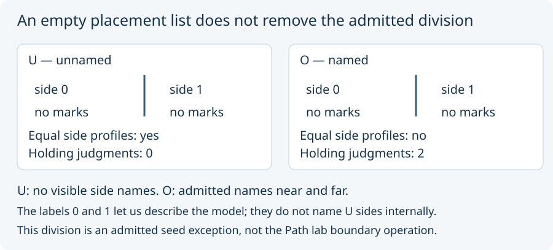

# 00. Start before the marks

**Question:** If neither side holds a mark, does the model contain nothing?

In `boundary_seed`, the starting whole is one supplied opaque datum.
*Opaque* means that its spelling supplies no further internal structure
beyond the explicitly admitted exception: a boundary with two sides.
The boundary is not a second supplied datum. It is a declared feature
of that starting whole.

No later mark has been placed. That tells us about the contents, not
that the declared boundary or starting whole has disappeared.

The seed supplies two readings:

- **U:** the sides have no internal names. With no marks on either side,
  their available positive reports give equal profiles.
- **O:** the sides have the admitted names *near* and *far*. Their empty
  placement lists agree, but their name reports differ.

A **profile** here is our collection of the available reports concerning
one side. Equality of those profiles is not equality of the sides
themselves. Nor does the U result prove that the sides must be physically
indistinguishable in a real application.

Our diagram labels the sides 0 and 1 so we can discuss them. Those labels
belong to our description; they do not silently add internal names to U.

There is a further language limit. The closed observation grammar has
mark-on-side and side-name reports. It has no separate “this side is
empty” report. We can count the contents from outside the model without
pretending that the model has admitted that counting question.

**Predict:** Before any mark is placed, does O already have a holding
name report? Does U? Keep the declaration and its consequences separate.

Next: [labels and identities](01_labels_and_identities.md).
