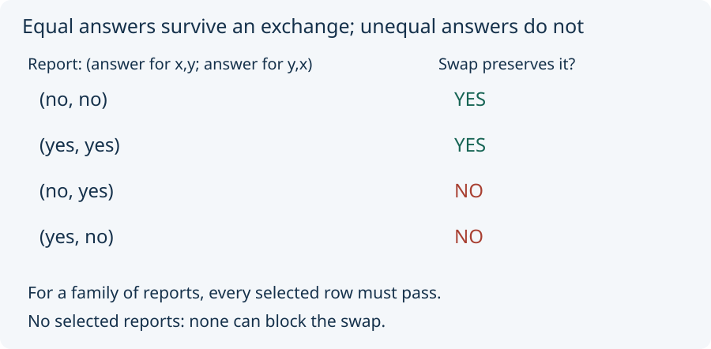

# 02. Compare two answers

We now change models explicitly. In `oriented_boundary`, one report is
represented by two yes/no answers: its answer on `(x, y)`, then its answer
on `(y, x)`. You can imagine asking whether an arrow goes from the first
dot to the second.

The **swap** exchanges x and y. In this stipulated model, the swap
*preserves* a report when its two answers agree. It *distinguishes* the
pair when the answers differ. These are declared opposite conditions.
Equal-answer reports are called *symmetric* here; unequal-answer reports
are *asymmetric*.

For example, `(yes, no)` changes to `(no, yes)` under the exchange.
The unequal answers are a **witness**: a particular report showing why
the swap fails the preservation test.

A family may contain several reports. The swap passes the family test
only if it preserves **every** admitted report. One unequal-answer report
is enough to block it. Adding equal-answer reports cannot rescue it.

For an empty family, the swap passes. There is no selected report for
it to violate. This is what “every selected report passes” means when
none is selected; it does not create a new distinguishing observation.

The source proves this for every finite report list, including repetitions.
Our desk also checks all 16 subsets of the four distinct reports.

**Scope:** The report stores only the two tested off-diagonal answers.
It does not store every feature of a relation, such as answers about
self-loops. Its swap test is not a general graph-preservation theorem
or a test of every property of two physical objects.

**Predict:** The reports are `(no, no)` and `(yes, yes)`. Does having
two reports, rather than one, block the swap?

Next: [two filters](03_two_separate_filters.md).
