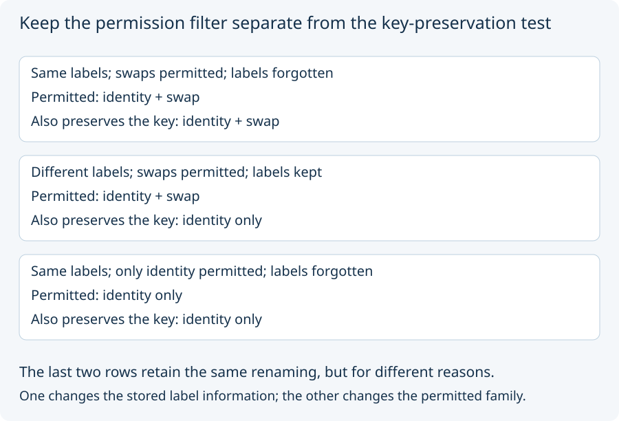

# 03. Apply two separate filters

Return to the side-free control. A **renaming** rearranges the admitted
mark identities. With two marks, the possibilities are identity (leave
them in place) and swap (exchange them).

The control applies two questions, in order:

1. **Is this renaming permitted by the candidate's rules?**
2. **Does it preserve the candidate's comparison key?**

A renaming that passes both is called a **permitted automorphism** here.
You can read that phrase as “an allowed rearrangement that leaves the
retained comparison information unchanged.”

With labels `[a, a]`, the swap survives even when labels are kept.
It changes neither label list nor mark count. With `[a, b]` and labels
kept, it changes the list to `[b, a]`, so it fails the second test.
If labels are forgotten, the key records only two marks and the swap
passes again.

A different candidate permits only identity. Then the swap fails the
**first** test, whether or not its image would have the same key.
No newly measured label difference has been demonstrated by that restriction.

The declared separation requirement holds when no permitted automorphism
carries mark 0 to mark 1. Both keeping genuinely different labels and
restricting the permitted family can make it hold, but they do so for
different reasons. The fixed source experiment starts with identical
labels, so the different-label case belongs to our separate transfer task.

The restriction is a priced capability in that experiment: admission
indices become internally available designations. It is not a discovery
that the base model already distinguished the marks.

Next: [the fixed price menu](04_price_a_fixed_menu.md).
