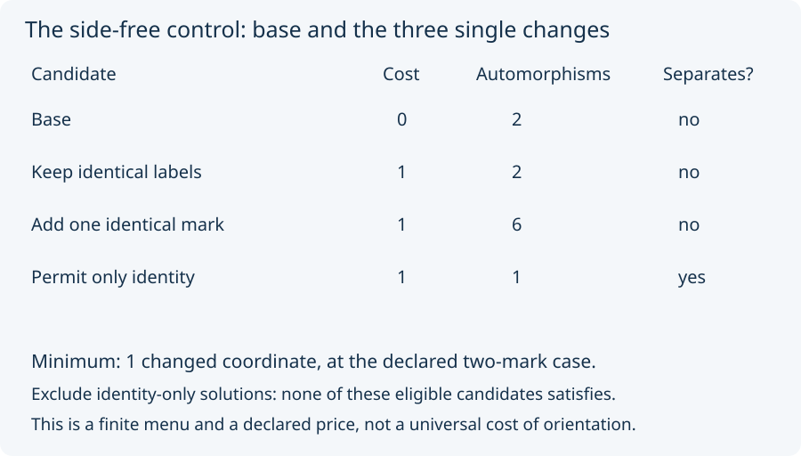

# 04. Price a fixed menu

Keep the source experiment's starting case fixed: two retained marks
with labels `[a, a]`. Its menu has three yes/no changes: restrict mark
permutations to identity, keep labels, and admit one extra `a` occurrence.

The declared price `mu1` counts how many of those settings change.
It is a capability count, not money, elapsed time, or the sealed
derivation's item-price measure.

The eight combinations include the base, three single changes, and four
bundles. **Only the base and single changes are eligible** for this
one-step minimum. The other combinations remain visible in the desk;
they are not silently discarded because they look inconvenient.

Work through the eligible rows:

1. Base permits the swap and fails the separation requirement.
2. Keeping two identical labels still permits the swap and fails.
3. A third identical mark still allows a permutation exchanging the
   first two, so that change fails too.
4. Permitting only identity prevents mark 0 moving to mark 1, so that
   candidate satisfies by the declared restriction.

Thus the least eligible cost is **1**, attained by one candidate and
one class in this declared comparison. The result is a bounded calculation,
with Lean checks for the source's four-row examples. It is not a proof
that every possible way to distinguish two objects costs one capability.

The source also asks a second question: exclude identity-only solutions,
then search the same eligible menu. No satisfying candidate remains.
That does not change the primary result. It exposes how much the answer
depends on what the requirement permits; whether it should have excluded
that route is still recorded as open.

Next: [carry the model](05_carry_the_model.md).
