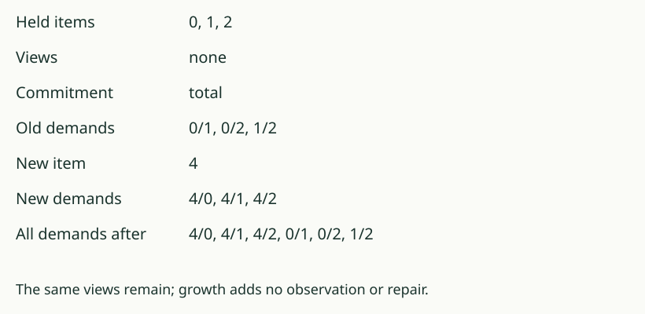

# 03. Grow without changing the views

[Previous](02_read_the_observations.md) · [Growth lab](README.md) · [Next](04_quiet_is_not_finished.md)

## Predict first

Hold 0, 1, 2, require every distinct pair apart, and supply no views.
Item 4 arrives. How many old demands remain? How many new ones appear?

## Growth has one stated effect

**Growth** adds the new item to the held list. It changes no view,
commitment, budget, or other field. In this example all three old demands
remain, and 4/0, 4/1, 4/2 are new demands. Three becomes six.

Here **fresh** means the new item's label is not already in the held list.

The general source result has this exact shape: after growth, the demand
list consists of the new item's unresolved committed pairs, followed by
the old demands. An old pair's observation answers did not change, so
growth alone cannot resolve its old demand.

## When is the increase exactly the old item count?

The counting theorem uses a fresh item, the `total` commitment, and no
views. Every old entry then supplies one new unresolved committed pair.
In our distinct-item examples, n old items therefore add n demands.

Remove a condition and that conclusion need not hold. Under `empty`,
no pair is required. With views, some new pairs may already be separated.
If the item is not fresh, the freshness argument no longer applies.

## Your turn

We hold only item 0, use view {0,1}, and admit item 4. Under `total`,
how many new pairs are possible, and how many are unresolved? Name the
counting theorem's missing condition.

AuthorityEffect: None. The source proves the stated conditional result;
it does not prove every model of growth must generate n new demands.
