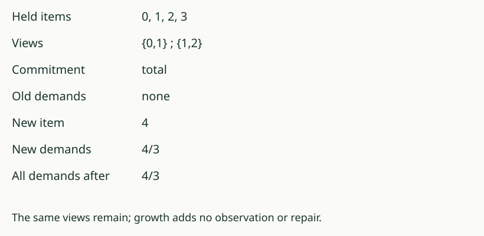

# 04. Quiet is not finished

[Previous](03_grow_without_repair.md) · [Growth lab](README.md) · [Next](05_account_for_service.md)

## Predict first

Hold 0, 1, 2, 3 with views {0,1} and {1,2}. Every distinct pair is
required apart. The current demand list is empty. Must it stay empty?

## Inspect the newcomer

The old answer patterns are (Yes,No), (Yes,Yes), (No,Yes), (No,No).
No two old items share a pattern, so every old requirement is met.

Now supply item 4 without changing either view. It answers (No,No),
just as item 3 does. The new pair 4/3 is required apart but is not
separated. It is a demand. All other new pairs are already separated.

The source's reopening result names its conditions: a fresh arrival,
an already held item, a commitment between them, and no current view
separating them. Under those conditions an empty demand list becomes nonempty.
It does not say that every arrival reopens every quiet state.

## Describe what was settled

“No demands remain for the currently held items under these views and
this commitment” states what passed. “No future work can arise” is a
stronger claim, and this example refutes it.

## Your turn

Keep the same views but use `bounded`. Does arrival 4 reopen the demand
list? Which condition of the reopening result now fails?

AuthorityEffect: None. This is a supplied represented-world growth step,
not an autonomous arrival mechanism or a claim about every changing system.
