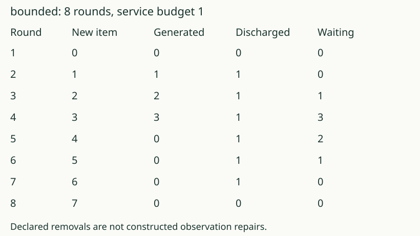
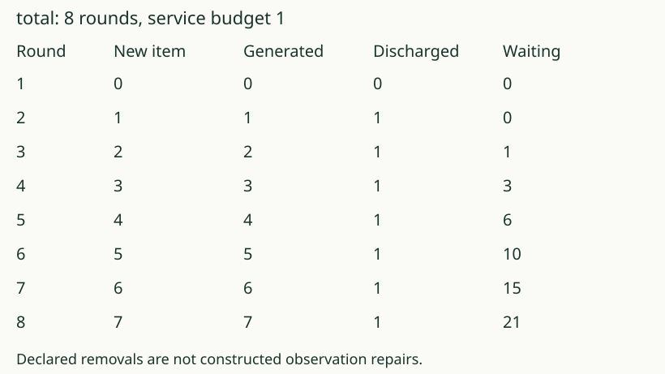

# 06. Test the tempting budget rule

[Previous](05_account_for_service.md) · [Growth lab](README.md) · [Next](07_keep_the_model.md)

## Predict first

For some rules, the least budget clearing a run equals its largest
single-round arrival count. Must that be true for every commitment?

## A counterexample with time to catch up

Use `bounded`: distinguish only labels among 0, 1, 2, 3. During eight
rounds its generated counts are 0, 1, 2, 3, 0, 0, 0, 0.
The busiest round adds three entries.

With budget one, the backlog after each round is 0, 0, 1, 3, 2, 1, 0, 0.
It temporarily reaches three, then the quiet rounds let service catch up.
Budget zero leaves six waiting. Thus one is the least clearing budget
for this eight-round run, although the peak arrival count is three.

## A useful pattern can have a limited domain

The source's four original commitments showed peak-equals-threshold
at its seven tested horizons. Its later `bounded` commitment was added
after the prediction freeze to refute the general rule. It was not an
additional successful frozen prediction.

Under `total`, by contrast, each successive round adds one more demand.
Budget one leaves 21 waiting after eight rounds in this accounting model.

## Your turn

For `bounded`, compare four rounds with eight. Explain why the same budget
can fail at the earlier horizon and clear at the later one. Is “a longer
run is always harder” established by these rules?

AuthorityEffect: None. These counts concern the supplied finite horizons
and service rule; no general queueing or physical law is inferred.
