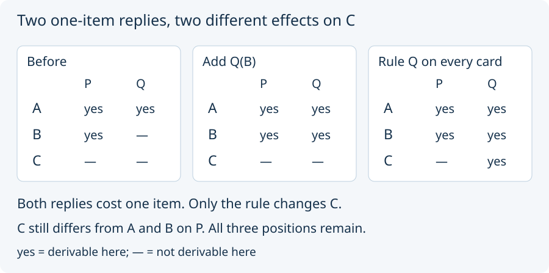

# 01. Compare two small replies

Return to A = `yes, yes`, B = `yes, —`, C = `—, —`.
The task is still to match A and B after releasing the old promises.

Two different additions work:

1. Admit the single instance Q(B).
2. Admit a *uniform rule* for Q: Q holds for every admitted card.

Both cost **one item** under the declared item-count price. A rule's
many consequences do not make it many items. This is a chosen price
convention, not a measure of writing time or physical effort.

Before reading further, predict C's two answers under each reply.

The instance changes B alone. The rule changes B **and C**: C now
answers yes to Q. Under either reply, C still differs from A and B
on P. Thus “C's profile changed” and “C became indistinguishable from
A” are different claims.

The finite search finds exactly these two one-item replies at this
starting state. Doing nothing fails, so one is the minimum item count
within the declared search. The two results remain distinct even after
allowed renamings of cards and forms; they are two alternatives, not a
single reply printed twice. The source comparison preserves their
admitted instances, rules, and requirements, not only this answer table.

Both also tie under the second source price, which compares item count
first and the sum of newly added form arities second. Neither adds a form.
There is no declared preference for fewer side effects.

Next: [questions with two places](02_questions_with_two_places.md).
