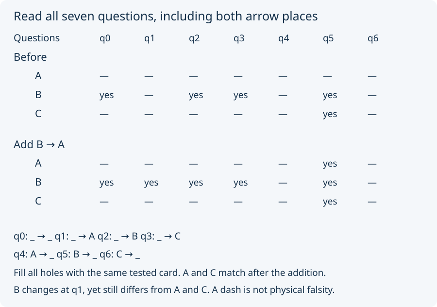

# 02. Read a question with two places

Use a new record. It has three cards and one two-place judgment, drawn
as an arrow. Initially only **B → B** and **B → C** are admitted.
An arrow here is a stored ordered pair; it does not describe motion.

To ask about a card, leave a hole in one or both places, then fill
every hole with that card. For example:

- `B → _` asks whether B points to the card being tested.
- `_ → A` asks whether the card being tested points to A.
- `_ → _` fills both holes with the **same** card; it asks about a loop.

With these three cards and this form there are exactly seven such
questions. The figure displays all seven, first before an addition,
then after it. A dash still means “not derivable here.”

The task is to match A and C, with the old promises released.
Add **B → A**. A and C now both answer yes only to `B → _`.
They match across all seven questions.

Predict whether B's profile also changes. It does: `_ → A` changes
from dash to yes when tested on B. We added an arrow ending at A,
but a question about B can see it. The effect of an admission depends
on every allowed question, not merely which card we mention as the goal.

B still differs from both A and C. Again, a changed profile need not
change which other profiles it matches.

Next: [promises and budgets](03_promises_and_budgets.md).
