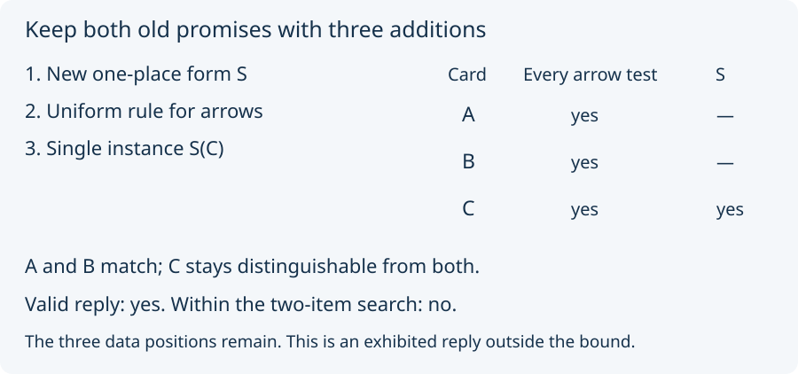

# 03. Keep the promise and the budget separate

Reset the arrow record to **B → B** and **B → C**. This time keep its
two old promises: A must remain distinguishable from C, and B must
remain distinguishable from C. Now ask to match **A and B**.

There is no direct promise to keep A and B apart. Still, the search
finds no valid reply using at most two items, with new forms having
at most two places. It checks the full admitted addition grammar,
not merely the two arrows discussed in Lesson 02.

An *item* is an added datum, a new form, a single instance, or a uniform
all-tuples rule. A new form is a new kind of question. These item kinds
and their price come from the source model.

Does the refusal mean matching A and B is impossible at every budget?
No. Here is an explicit three-item reply:

1. Add a new one-place form S.
2. Add a uniform rule for the old arrow form.
3. Admit S(C), leaving S(A) and S(B) underivable.

All seven arrow questions now give yes for all three cards. The new
question S distinguishes C from both A and B. A and B have equal
profiles, and both old promises survive. No identity was merged.

This reply passes the source's validity check but exceeds the search's
two-item limit. Validity and admission within a resource bound are
separate checks. We exhibit this reply; we do not run a general
three-item search or claim a general budget law.

Next: [price the next step](04_price_the_next_step.md).
