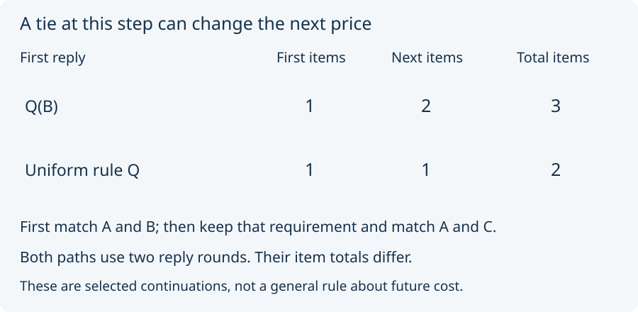

# 04. Price the next step

Return to the two-question record from Lesson 00. Release the old
separation promises. First match A and B. Keep that new equality
requirement, then ask to match A and C as well.

The first step has the two one-item replies from Lesson 01. Predict
how each affects the next step's least item count.

After the focused instance Q(B), A and B have both answers and C has
neither. To match C with them requires two more items. One possible
reply adds uniform rules for P and Q. The search finds no one-item
reply that meets both equality requirements here.

After the uniform rule for Q, C already answers yes to Q. One more
item, a uniform rule for P, suffices. No zero-item reply works.

The selected continuations therefore cost **three** items and **two**
items in total. Both use two response rounds. Counting rounds and
counting admitted items are different measurements.

There is no contradiction with the earlier tie. The first price
compares the immediate replies. It says nothing by itself about a
later demand. We have calculated these particular continuations;
we have not proved that a uniform rule always improves future cost,
or optimized every possible sequence of future demands.

Next: [recheck the shortcut](05_recheck_the_shortcut.md).
