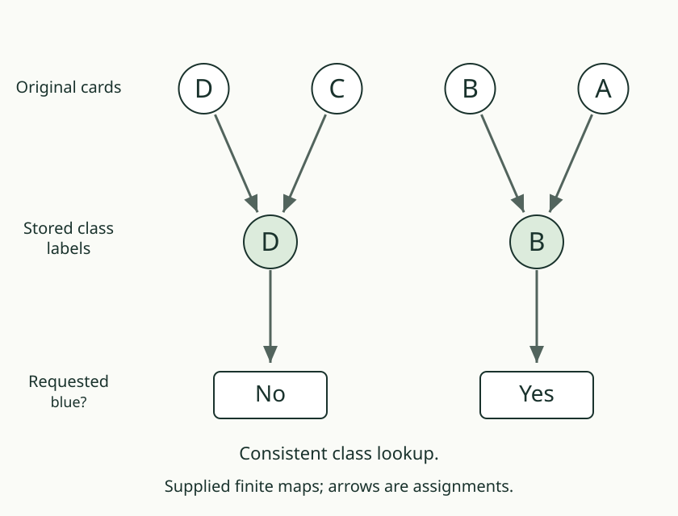

# 02. Choose a representative

[Previous](01_agreement_and_classes.md) · [Map lab](README.md) · [Next](03_answer_from_the_group.md)

## Predict first

For the blue groups A/B and C/D, choose A and C as class labels.
Would choosing B and D instead let us recover triangle?

## Name a whole group by one member

A **representative** is a chosen member used to label its entire class.
Our source rule chooses the first member of each class in the declared
domain order. With A, B, C, D, the labels are A and C. With the reverse
order D, C, B, A, the labels are D and B.

The class membership has not changed. A and B still share a label, and
their triangle answers still differ. A new representative supplies no
new distinguishing question.

The map that sends every item to its class is a **quotient map**. Our
finite recorder labels each class by its chosen representative. The
class is the whole group, not a claim that its members became one object.

## Follow the selected domain

Select only B and D. In forward order, the representatives are B and D.
The source routine returns its representative values in the selected
domain's order. Its two returned entries correspond to B and D; they
are not entries for original positions A and B.

The desk preserves that alignment explicitly. Do not confuse a label,
its original position, and its position in a shortened list.

## Your turn

Keep only blue and reverse the domain order. Name each class's members,
its new representative, and a blocking pair for triangle recovery.

AuthorityEffect: None. Representative selection is a declared convention,
not a theorem that one class name is uniquely preferred.
