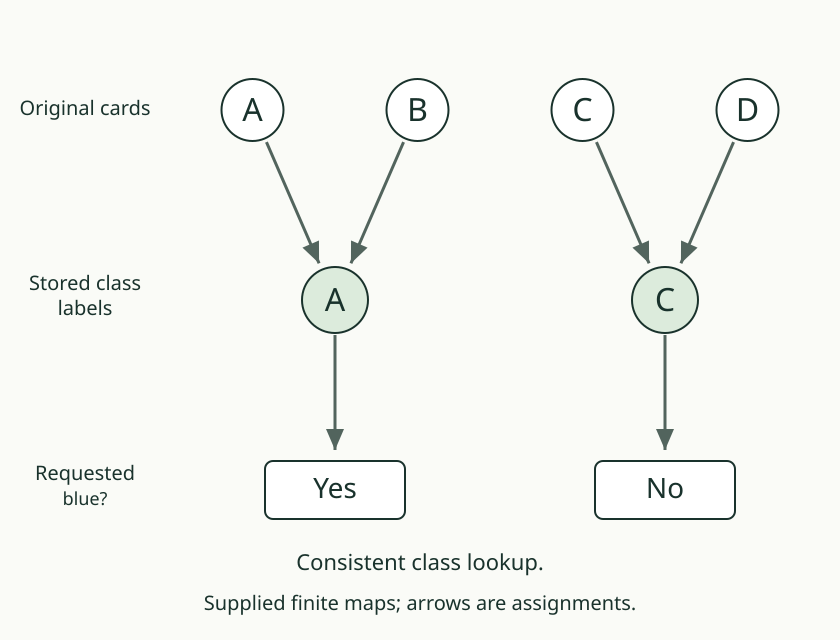
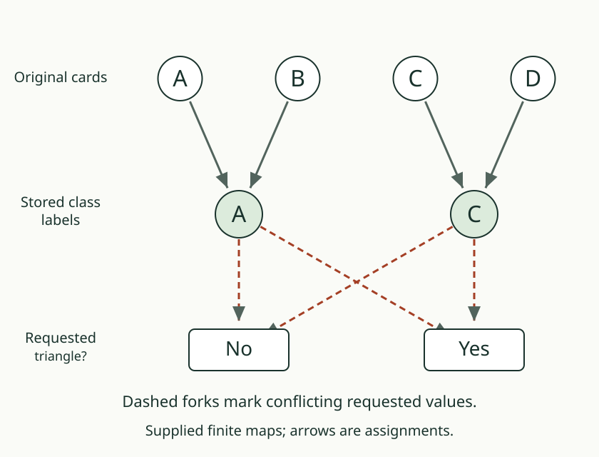
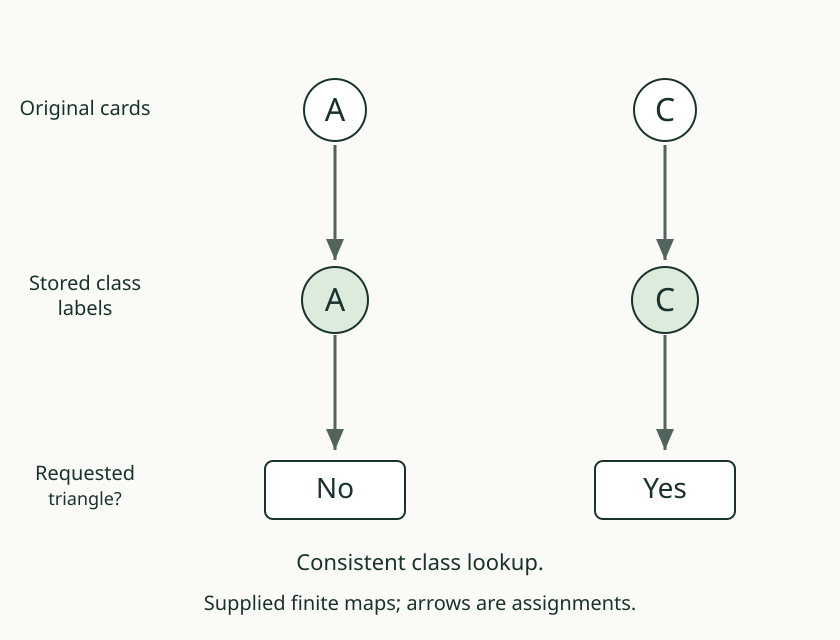

# 03. Make the answer descend

[Previous](02_choose_a_representative.md) · [Map lab](README.md) · [Next](04_pair_the_questions.md)

## Predict first

Using the blue groups, can we assign one triangle answer to the group
A/B that agrees with both original cards?

## The consistency test

An answer is **constant on a class** when it has the same value on every
member of that class. It may differ between classes.

If every class passes this test, we can assign its common answer to the
class label. Computing the answer from the class alone is called
**descent**. In the finite map language, q **factors through** p when
a lookup g gives q(x) = g(p(x)) for every selected x.

For the requested blue answer, A/B needs Yes and C/D needs No. The class
lookup is consistent. For triangle, A/B needs both No and Yes. One such
pair is enough to refute the existence of a successful class lookup.

## Check both directions of the criterion

If a lookup works, equal stored inputs must give equal requested outputs,
because a function assigns one output to each input.

Conversely, if every stored group has one requested value, assign that
value to the group's label. This constructs the required lookup on the
labels actually used. We have explained why the criterion is two-way,
rather than treating a successful example as proof of its reverse.

## Your turn

Select only A and C. With blue kept, construct the triangle lookup.
Then add B back and identify exactly which lookup input becomes inconsistent.

AuthorityEffect: None. The source map distinguishes this domain-relative
criterion from the native global observer-quotient theorem.
