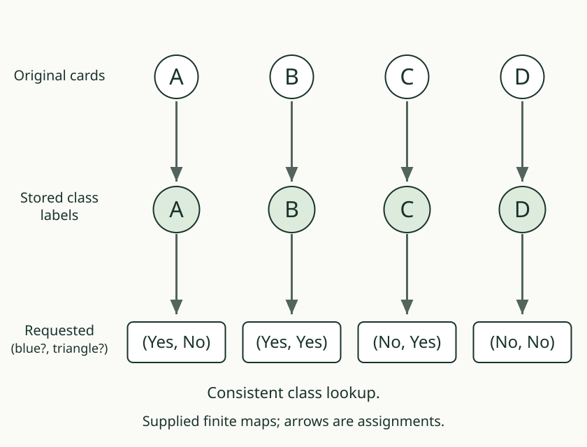

# 04. Ask two questions together

[Previous](03_answer_from_the_group.md) · [Map lab](README.md) · [Next](05_change_the_right_thing.md)

## Predict first

Keep blue only. Blue is recoverable. Is the pair of requested answers
“blue and triangle” therefore recoverable too?

## A pair contains both components

The pair is an ordered record: first the blue answer, then the triangle
answer. A has (Yes, No), while B has (Yes, Yes). Both still have the same
stored blue value. Their paired requested answers therefore disagree.
Recovering the first component alone does not recover the pair.

An ordered pair of answers is recoverable exactly when both components
are recoverable:

1. If a pair lookup works, read its first output to recover the first
   component and its second output to recover the second.
2. If each component has a successful lookup, apply both to the stored
   input and put their outputs together.

This explains both directions. Neither requires the components' answers
to equal each other; each only needs to be constant within a stored class.

## Supply the additional input

Keep both blue and triangle. Now each card has its own answer pattern.
The pair is recoverable. We changed the recorded information, not the
wording of the recovery test.

## Your turn

Keep triangle only. Which component of the requested pair is recoverable?
Give a blocking pair for the other. Explain why the whole pair fails.

AuthorityEffect: None. The native pairing theorem concerns the stated
functions and observer classes, not an automatic combination of devices.
