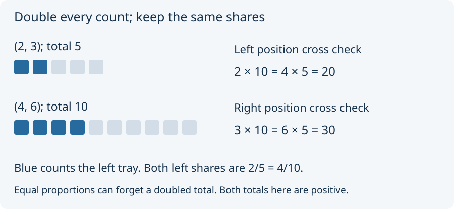

# 01. Compare shares

The left tray holds 2 of the 5 counters. We write its share as **2/5**,
read “two fifths”: divide the total into five equal parts and take two.
The right tray's share is 3/5. Together they account for the whole total.

Double every tray count. The new table is `(4, 6)`, with total 10.
Predict whether the left tray's share becomes larger.

It does not. Four of ten is the same share as two of five. The raw
total has doubled, but the proportions agree.

We can compare the shares without doing division. Multiply each entry
by the **other table's total**. For the left tray, 2 × 10 = 4 × 5 = 20.
For the right tray, 3 × 10 = 6 × 5 = 30. Both positions pass.

Unit 64 calls this arithmetic relation `SameProfile`. Here it means
equal cross-multiplied proportions. It is a different definition from
the yes-question profiles in First steps; a shared word supplies no
bridge between the two models. When both totals are positive, this
arithmetic test agrees with comparing all the fractional shares.

Change the second table to `(6, 4)`. The left check becomes
2 × 10 = 20 versus 6 × 5 = 30, so the proportions differ. Equal totals
alone do not guarantee equal shares.

Next: [check zero](02_check_zero.md).
