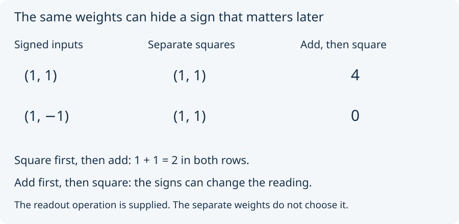

# 04. Square before or after adding?

Take two signed inputs. Record each square separately as its weight.
Then define a new combined reading: **add the inputs first, then square**.
We have supplied this readout rule; the separate weights do not select it.

Predict the combined reading for `(1, 1)` and `(1, −1)`.

Both inputs have separate weights `(1, 1)`. But their combined readings
differ: (1 + 1)² = 2² = 4, while (1 + (−1))² = 0² = 0.
The separate squares forgot a sign that this new rule can detect.

Compare a different calculation: **square first, then add**. It gives
1² + 1² = 2 and 1² + (−1)² = 2. Adding before squaring and squaring
before adding are different operations. Neither answer is a correction
of the other; each follows its stated rule.

Change the inputs to `(2, 1)` and `(2, −1)`. The separate weights are
now `(4, 1)` in both cases. Add-then-square gives 9 and 1. The example
is not tied to the special numbers 4 and 0.

Unit 64 proves its signed-square split within an admitted arithmetic
setting. It supplies no dynamics and no measurement correspondence.
We next add a second coordinate to see a third reading on one weight row.

Next: [two coordinates](05_two_coordinates.md).
