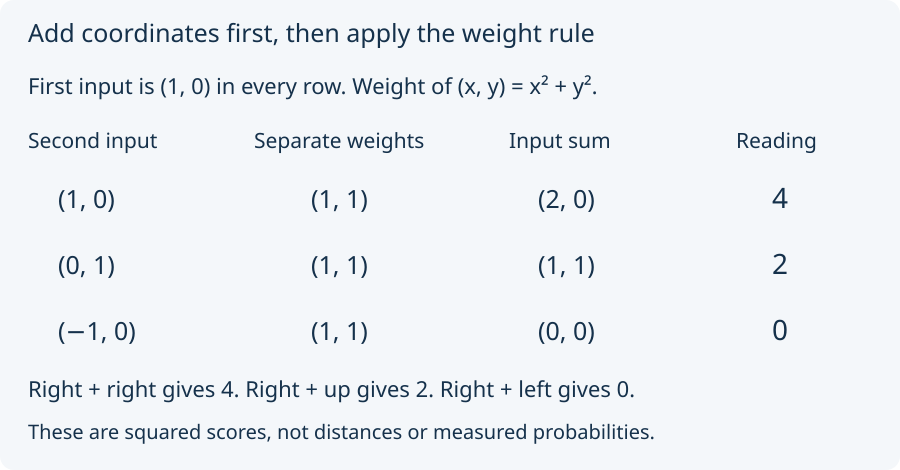

# 05. Add two coordinates

An ordered pair `(x, y)` records two signed coordinates. The first
counts horizontal steps; the second counts vertical steps. For example,
`(1, 0)` is one step right, and `(0, 1)` is one step up. Add pairs by
adding their first coordinates and then their second coordinates.

Define the pair's *weight* to be **x² + y²**. Thus `(1, 0)`, `(0, 1)`,
and `(−1, 0)` each have weight 1. This weight is a squared score;
it is not ordinary distance. For example, `(3, 4)` has weight 9 + 16 = 25.

A preparation now contains **two** such coordinate pairs. Its separate
weight row lists their two weights. Its combined reading is the weight
of their coordinate-wise sum. Predict all three rows below.

Hold the first pair at `(1, 0)`. With the second also rightward, the
sum is `(2, 0)`, with weight 4. With the second upward, the sum is
`(1, 1)`, with weight 2. With the second leftward, the sum is `(0, 0)`,
with weight 0. All three separate weight rows are `(1, 1)`.

These are the research model's exact supplied examples, written as
integer pairs before introducing its optional source notation. We did
not infer two-coordinate arithmetic or the readout rule from the weights.
Turn the second pair downward to `(0, −1)`: the reading is again 2.

Next: [what the weights determine](06_what_weights_determine.md).
