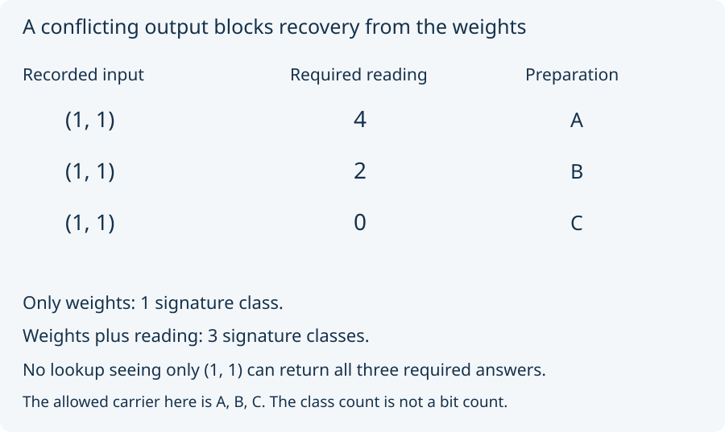

# 06. Ask what the weights determine

Call the three preparations from Lesson 05 A, B, and C. Their entire
separate-weight record is the same, but their combined readings differ.

| Preparation | Separate weights | Combined reading |
|---|---|---:|
| A | `(1, 1)` | 4 |
| B | `(1, 1)` | 2 |
| C | `(1, 1)` | 0 |

Suppose your lookup is allowed to see **only the separate weight row**.
What should it return for `(1, 1)`? Returning 4 fails on B and C;
returning 2 fails on A and C; returning 0 fails on A and B. One input
cannot determine three different required outputs.

The [Map lab](../map_lab/README.md) calls this a blocked recovery.
The research expresses it as a question the weight record does not
determine. That claim needs only the finite input/output table. It
does not need to assume why the outputs differ.

Adding the combined-reading question splits one recorded class into
three. Here *information* counts distinguishable signature classes:
it rises from 1 to 3. It is not a count of bits or a measure of a
person's understanding. The three preparation labels remain distinct
throughout; a one-class record never merged their identities.

If the allowed carrier contains only A, the weights do determine the
reading there: always return 4. If the carrier contains A and B,
they do not. The source's determination claim always carries its
specified domain. Do not silently extend it to every possible input.

Next: [pair positions under reversal](07_pair_positions.md).
