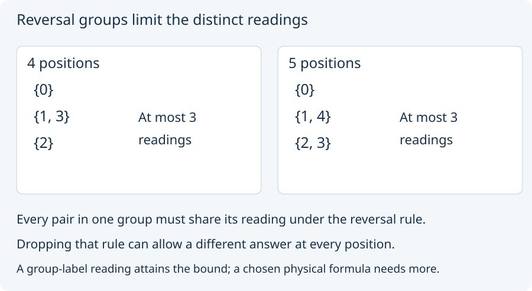

# 07. Pair positions under reversal

Place four numbered positions around a loop: 0, 1, 2, 3, then back to 0.
Reversal fixes 0 and 2 and exchanges 1 with 3. Now admit a rule:
**reversing a position must preserve its reading**.

Positions 1 and 3 must then give the same reading. At most three
different readings can occur, one for each group `{0}`, `{1,3}`, `{2}`.
For the coordinate example, positions 0–3 choose right, up, left, and
down for the second input. This four-position example realizes that
limit with readings 4, 2, 0, 2.
It does not claim four distinguishable readings.

Predict the groups for five positions. They are `{0}`, `{1,4}`, `{2,3}`:
again three groups. For six positions there are four groups:
`{0}`, `{1,5}`, `{2,4}`, `{3}`. A group can share an answer with
another group too, so the group count is an upper bound, not a
guarantee that every permitted readout uses all of it.

For a general positive number N of positions, the source proves that
the number of different reversal-preserving readings is at most half
of N, rounded down, plus one. It also constructs a reading attaining
that bound. This is a statement about **some admitted reading**;
it does not prove a particular coordinate formula attains it at every N.

Drop the reversal rule and use the position number itself as the
reading. Four positions now give four answers. The earlier bound no
longer applies. Its hypothesis did real work.

Finite distinct-reading tasks of this form have finite constructions.
They do not by themselves require an unlimited continuum of positions.

Next: [test the interpretation](08_test_the_interpretation.md).
