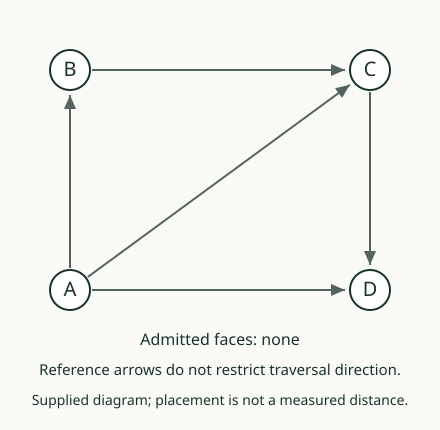

# 00. Read a graph

[Path lab](README.md) · [Next](01_follow_a_walk.md)

## Predict first

We list four points A, B, C, D and the connections AB, BC, AC, CD, AD.
Is there a connection BD? Does putting B near D on the page supply one?

## Two lists give the graph

A **vertex** is a listed point. An **edge** is a listed connection between
two different vertices. A **graph**, in this lesson, consists of the
vertex list and edge list. We allow at most one edge per unordered pair:
AB and BA name the same connection here.

The positions used to draw the vertices help us read the lists. Moving
a point on the page changes no edge. The length or angle of a drawn line
does not carry an additional measured value in this example.

| Vertex list | Edge list | Absent example |
|---|---|---|
| A, B, C, D | AB, BC, AC, CD, AD | BD |

BD is absent even though B and D are both present. Listing vertices
and listing a connection are different additions.

## A triangle outline is not yet a face

AB, BC, and AC form an outline. For now we have listed three edges,
not a filled triangular face. The face will need its own record and a
stated admission rule. A picture shaded by an artist would not supply
that record by itself.

## Your turn

Remove AC in the desk. Which edges remain? Have A or C disappeared?
Explain why deleting a connection and deleting its endpoints are different.

AuthorityEffect: None. The finite graph is supplied; the source encoding
stores each edge as an ascending two-vertex list.
