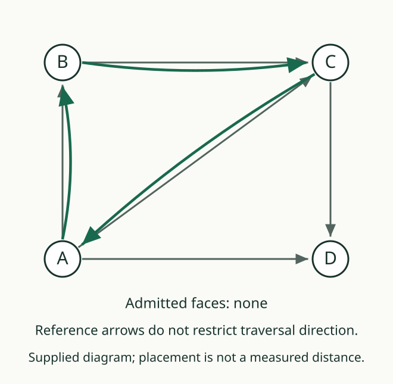
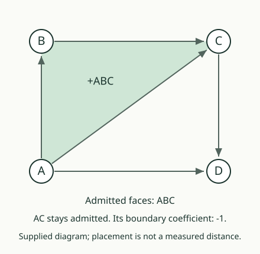

# 03. Closed does not mean filled

[Previous](02_signed_endpoint_counts.md) · [Path lab](README.md) · [Next](04_a_faces_boundary.md)

## Predict first

AB, BC, and AC are present. We can walk A → B → C → A, and its endpoint
boundary is zero. Has a triangular face ABC thereby been admitted?

## A face is additional data

A **triangular face** is a separately listed cell with three different
vertices. Its three edge facets are AB, AC, BC. A **facet** is obtained
by deleting one vertex from the cell's ordered vertex list; for a triangle
these are its three edges.

The **dimension** labels these cell kinds: a vertex has dimension zero,
an edge one, and a triangular face two. It is not a measurement read from
the size of the drawing.

This lab uses the source's declared rule for admitting a face:

1. Its vertex list has exactly three entries in increasing order, with
   no repeated vertex.
2. All three edge facets are already present.
3. This face is not already present.
4. We actually apply the face-admission step.

The first three are the **guard**, the conditions that allow the step.
Meeting them does not perform the step. With no face request, the face
register stays empty even when a closed outline is present.

## A missing edge and a repeated request

Remove AC. Requesting ABC now changes nothing because a facet is absent.
Restore AC and apply the request: ABC is added. Applying the same request
again does not add another copy; the face is already present.

The all-zero endpoint tally is neither this guard nor the face register.
It cannot replace the missing admission evidence.

## Your turn

Keep every edge and request only ACD. Which triangle's face is present?
Can ABC still have a closed edge walk while its own face remains absent?

AuthorityEffect: None. The guarded cell step is consumed from LadderGeneral;
it contains no passage budget, observer, or permission field.
