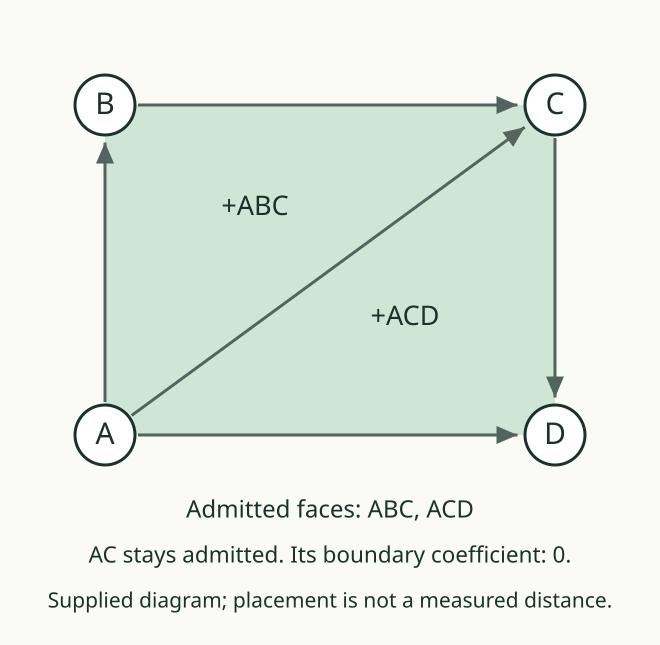
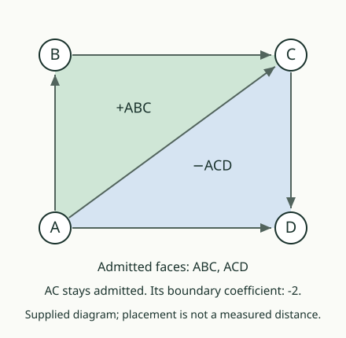

# 05. Join two faces

[Previous](04_a_faces_boundary.md) · [Path lab](README.md) · [Next](06_conventions_and_scope.md)

## Predict first

Admit ABC and ACD. Add their signed boundary lists. Which edge occurs
twice, once in each direction?

## Keep the contributions before combining them

| Face | Signed boundary |
|---|---|
| ABC | +AB +BC −AC |
| ACD | +AC +CD −AD |

The two AC contributions cancel: −1 plus +1 gives zero. The remaining
list is **+AB +BC +CD −AD**. It follows the outer route
A → B → C → D → A.

The shared edge still exists in the cell register. Its **coefficient**,
the combined signed count in this particular boundary sum, is zero.
A zero coefficient does not delete an admitted edge.

A **chain** here is a finite list of cells with integer coefficients.
We formed a two-face chain with coefficient +1 on each face. Taking its
boundary means taking each face's boundary, keeping its coefficient,
and adding the contributions to equal edges.

## Two faces, not a new four-vertex cell

The combined outer route does not admit a square face or a tetrahedron.
The declared triangular cells are ABC and ACD. A four-vertex cell in
this source has a different dimension and its own facet guard.

If one triangle was not admitted, it does not appear in our admitted-face
chain. We may still calculate a candidate's formula, but that calculation
alone supplies no admission record.

In this changed sum, the two AC contributions have equal negative signs.
Merely sharing an edge does not ensure cancellation.

## Your turn

Request both faces but remove BC. Which face request fails? Which face
can still succeed? Compute the boundary of the faces actually admitted.

AuthorityEffect: None. Coefficient cancellation and cell membership are
separate records, checked separately by the desk.
