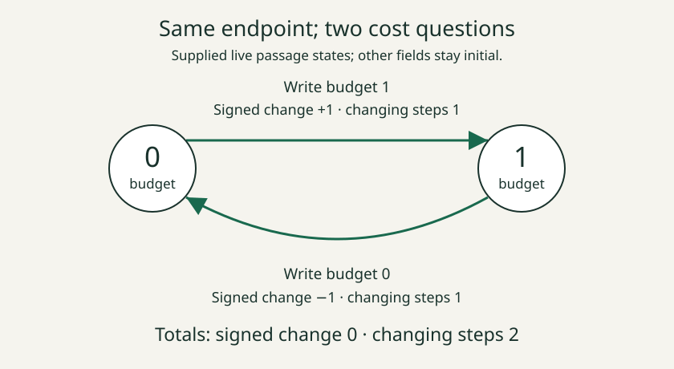

# 09. Test a return loop

A **loop** is an actual event history whose end state equals its start
state. Equality here concerns the whole state, not just one register.

Start live at budget 0 with license on, and write budget 1, then 0.
Every other field stays initial. This really returns to the same state.

**Predict:** could the state-change count be an exact cost under some
different potential, even though budget itself does not work?

Exclude every potential

If a potential existed, telescoping would make this loop's total equal
the potential at its end minus the potential at its start. Those are the
same state, so the difference would be 0. The actual state-change count
is 2. Therefore no potential can give this cost on every native step.
The argument excludes every potential, rather than just one failed guess.

## Keep the full-state condition

**Try a change:** after the two budget writes, also turn license off.
The budget is back at 0, but the license has changed. That longer history
is not a loop from the original full state. Equal answers to “what is
the budget?” do not establish equal states.

An empty history is a loop with cost 0. Finding that one zero-cost loop
does not prove a potential exists. A single nonzero loop is enough to
rule a potential out; a single zero loop is not enough to rule one in.

This is a general logical pattern: a witness can refute an “every” claim,
while one successful example cannot establish it.

Continue with [10. Check a commuting square](10_check_a_commuting_square.md).

AuthorityEffect: None. NS-7 proves `not_exact_of_cycle`; NS-8 applies it
to the actual budget loop to prove `writes_not_exact`. The book rechecks
the loop's full-state equality and both cost totals.
